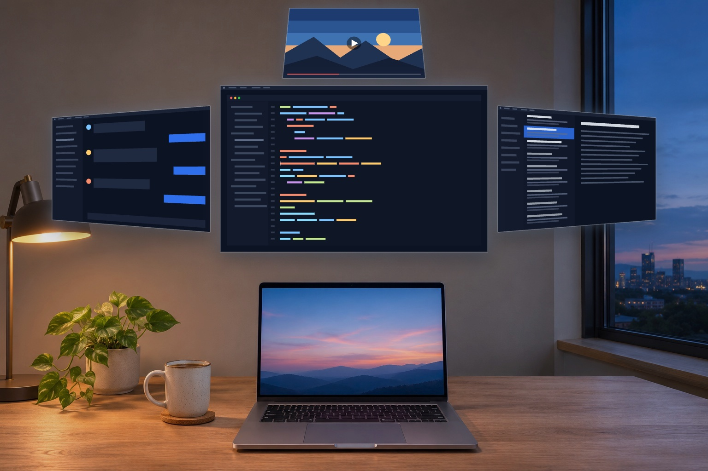
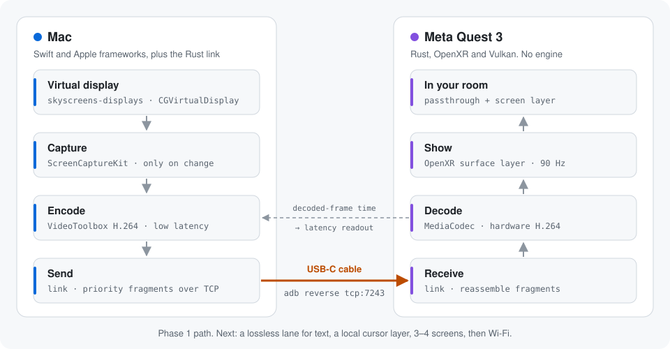

# skyscreens

**Extra monitors for your Mac, inside a Meta Quest 3.** Open source, no account, no cloud.

<p align="center">
  
</p>

skyscreens adds virtual displays to your Mac and streams them to the headset, where they float in your room like real monitors. macOS treats them as real displays, so windows, Spaces, your keyboard, trackpad and cursor work across them as usual. You still see your desk through passthrough.

> [!IMPORTANT]
> **Early development. Nothing to install yet.** Phase 1 of 5 is built: one Mac screen streamed to the Quest over USB-C, with a live latency readout. Its first test on the headset is next. See the [roadmap](#roadmap), or [help build it](CONTRIBUTING.md).

## Why skyscreens

- **Text as sharp as the headset allows.** Screens are sized to the Quest's pixels, not to monitor resolutions. Each screen is its own OpenXR compositor layer, which avoids an extra resampling step. Typing and other small changes will travel losslessly instead of as video.
- **Low latency by design.** Hardware encoding and decoding on both sides, no game engine, and a target of 25 ms from key press to visible text over USB. `skyscreens stream` prints the latency it measures every second.
- **Private.** No account, no sign-in, no cloud. The stream goes over your cable (later, your own Wi-Fi) and nowhere else.
- **Measured, not guessed.** Every design decision comes from benchmarks on real hardware, in [`bench/`](bench) and [docs/architecture.md](docs/architecture.md).

## How it works

<p align="center">
  
</p>

1. A small helper process creates virtual displays with `CGVirtualDisplay`. macOS treats them like plugged-in monitors.
2. ScreenCaptureKit captures a display only when something on it changes.
3. VideoToolbox encodes H.264 in low-latency mode on the Mac's media engine.
4. The `link` crate (Rust, shared by both apps) splits each frame into prioritized fragments and sends them over TCP. Over USB, `adb reverse` carries that connection.
5. The headset app decodes with MediaCodec straight into an OpenXR surface layer. The compositor shows the newest frame over passthrough.
6. The headset sends back each decoded frame's timestamp, and the Mac prints the round trip.

Next come a lossless LZ4 lane for text, a cursor drawn locally in the headset, 3–4 screens, Wi-Fi with error correction, and encryption. The full design and the measurements behind it are in [docs/architecture.md](docs/architecture.md).

## Roadmap

| Phase | What you get | Status |
|---|---|---|
| 0 | Toolchains, plus an empty Quest app with passthrough and a test screen | Done, verified on a Quest 3 |
| 1 | One Mac screen over USB-C, with a latency readout | Built, device test next |
| 2 | Lossless text, a local cursor, 3–4 screens, one-shortcut On/Off | Planned |
| 3 | Wi-Fi and phone hotspot, pairing, encryption | Planned |
| 4 | Moving and resizing screens, Quest controllers and keyboard, settings | Planned |
| 5 | Other headsets: Android XR (Samsung Galaxy XR, XREAL Project Aura), Steam Frame | Planned |

## Measured so far

| What | Result |
|---|---|
| H.264 encode of a 1920×1080 frame, M2, low-latency mode | 7.5 ms p50 |
| LZ4 lossless encode of a typing-sized patch | 0.01 ms, 30 KB → 2.6 KB |
| Typing latency over USB, full design, simulated | 21 ms p50 |
| Quest 3 showing a 1616×1008 test screen | 90 FPS, about 1–2 ms of app time per frame |
| Quest 3 hardware decoders | 16 H.264/HEVC instances, up to 8192×8192 |

The numbers, their sources and the open questions are in [docs/architecture.md](docs/architecture.md#key-findings-and-the-decisions-they-drove).

## Requirements

- A Mac with Apple Silicon and macOS 14 or later. Development uses a MacBook Air M2 on macOS 26.
- A Meta Quest 3 with [Developer Mode](docs/development.md#set-up-the-quest) on. The Quest 3S should work too, but nobody has tested it yet.
- A USB-C data cable. USB 2 speed is enough: the stream needs about 15–30 Mbps.

`CGVirtualDisplay` is a private macOS API, so skyscreens can't ship on the Mac App Store, and a future macOS update could break it.

## Build it

The [development guide](docs/development.md) covers the full setup: toolchains, code signing, the Quest, and troubleshooting.

```sh
cargo test -p link                 # protocol tests, no devices needed
mac/scripts/bundle.sh              # builds mac/.build/Skyscreens.app
xr/build.sh --install              # builds the headset APK and installs it over adb
mac/scripts/run.sh stream          # streams one screen to the plugged-in Quest
```

## Repository map

| Path | What's there |
|---|---|
| [`mac/`](mac) | Swift package: the `skyscreens` CLI, the `skyscreens-displays` helper, capture, encoding, the streamer |
| [`crates/link/`](crates/link) | Rust: the wire format, priority sender, reassembler, and the C interface for the Mac app |
| [`xr/`](xr) | Rust: the headset app (OpenXR, Vulkan, MediaCodec), built into an APK without Gradle |
| [`bench/`](bench) | The benchmarks and simulations behind the design |
| [`docs/`](docs) | Architecture, the development guide, and the images used here |

## For AI agents

Using an AI coding agent on this repo? Point it to [AGENTS.md](AGENTS.md). It covers the commands, the rules, and the pitfalls already found. Agents that are only researching the project can start from [llms.txt](llms.txt), a short index of everything here.

## Contributing

Contributions are welcome, especially tests on other Macs and headsets. Start with [CONTRIBUTING.md](CONTRIBUTING.md). To report a security problem, see [SECURITY.md](SECURITY.md).

## License

[MIT](LICENSE) © 2026 Adrián Ambrosetti

skyscreens is not affiliated with or endorsed by Meta or Apple. Meta Quest is a trademark of Meta Platforms, Inc. Mac is a trademark of Apple Inc.
